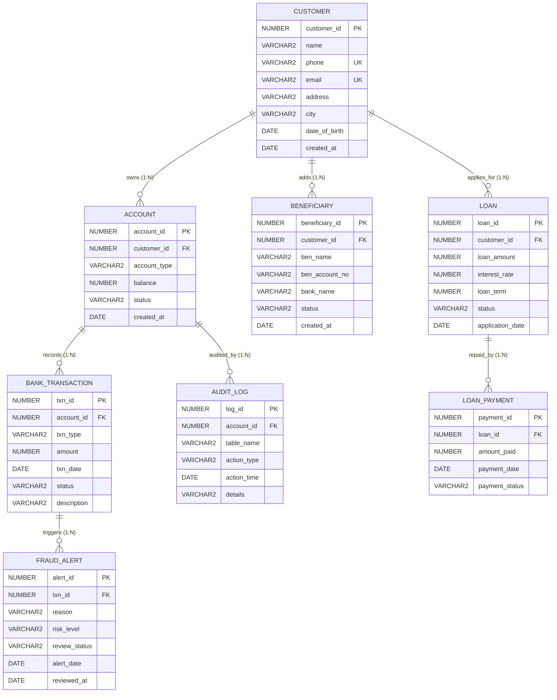

# SecureBank — Smart Banking Management System with Database-Based Fraud Detection

**Course Project Report — BCSE302L: Database Systems**  
**School of Computer Science Engineering and Information Systems (SCOPE)**  
**Vellore Institute of Technology (VIT), Vellore**

---

> [!WARNING]
> ### Academic Topic Allocation Discrepancy Notice
> **Important Note for Evaluation / Faculty Verification**:  
> In the institutional topic allocation table for the laboratory component, student registration number **`24BDE0023`** was originally assigned the domain **`Hospital Management`**. However, the current project specifications and student laboratory requirements requested the implementation of **`SecureBank — Smart Banking Management System with Database-Based Fraud Detection`**.  
> This report documents the full implementation of the **SecureBank** project per the primary guidelines. Students must confirm this topic reconciliation with their course instructor.

---

## 1. Project Title and Team Details

| Item | Details |
|---|---|
| **Project Title** | SecureBank — Smart Banking Management System with Database-Based Fraud Detection |
| **Course Code & Title** | BCSE302L — Database Systems / BCSE302P — Database Systems Lab |
| **Academic Semester** | Fall Semester 2026–2027 |
| **Domain** | Banking & Financial Technology / Database Security |
| **Team Member 1** | Dhyansh Prasad (Reg. No: `24BDE0023`) |
| **Team Member 2** | Rohit Sohu (Reg. No: `24BDE0163`) |
| **Team Member 3** | Shreyansh Khandelwal (Reg. No: `24BDE0160`) |
| **Faculty Guide** | [Faculty Guide Name Placeholder] |
| **Institution** | Vellore Institute of Technology, Vellore, Tamil Nadu, India |

---

## 2. Introduction and Problem Statement

### 2.1 Introduction
**SecureBank** is an enterprise-grade banking management system built upon an **Oracle Database** engine with a Python **FastAPI** backend and responsive modern web user interface. It manages customers, bank accounts, monetary transactions, transfer beneficiaries, loans, and loan repayment schedules.

Banks process hundreds of thousands of monetary transactions daily, demanding uncompromising data integrity, ACID compliance, zero tolerance for negative account balances, and automated auditing.

The defining architectural innovation of SecureBank is **database-based, rule-driven fraud detection**. Rather than delegating transaction risk evaluation to volatile external web applications or ephemeral memory caches, SecureBank embeds deterministic risk evaluation rules directly inside Oracle PL/SQL functions, triggers, and stored procedures. Suspicious transactions (e.g. transfers exceeding ₹1,00,000 or rapid balance drains exceeding 80% of account holdings) are automatically intercepted, flagged as `SUSPICIOUS`, and stored in a specialized `FRAUD_ALERT` table for compliance review.

> [!NOTE]
> **Database Scope Clarification**: This is a pure DBMS engineering project. No external AI/ML black-box models are utilized. Fraud detection is strictly rule-based, deterministic, explainable, and executed natively by Oracle database triggers, functions, procedures, and cursors.

### 2.2 Problem Statement
Traditional decentralized or basic banking applications suffer from severe architectural limitations:
1. **Inconsistent Data & Duplicate Accounts**: Without strict primary key, unique, and foreign key constraints, customer and account records become corrupt or redundant.
2. **Race Conditions & Balance Inconsistencies**: Naive money transfers that deduct from sender and credit to receiver in separate disconnected queries risk phantom balance losses during network interrupts or concurrent requests.
3. **Delayed Threat Detection**: Suspicious or abnormally large cash drains often go unnoticed until end-of-day batch reconciliation or manual audits.
4. **Lack of Immutable Audit Trails**: Unaudited updates to account balances make tracking unauthorized administrative modifications impossible.

### 2.3 Objectives
1. Design and normalize an 8-table relational database to at least Third Normal Form (3NF).
2. Enforce absolute relational integrity using PK, FK, NOT NULL, UNIQUE, CHECK, and DEFAULT constraints.
3. Guarantee atomic money transfers using Oracle PL/SQL transactions with explicit row-level locking (`FOR UPDATE`), `COMMIT`, and `ROLLBACK` handling.
4. Implement database-level fraud detection rules (Rules R1, R2, and R3) using native PL/SQL functions and triggers.
5. Provide a batch processing explicit PL/SQL cursor (`check_high_risk_accounts`) to automate high-risk account freezes.
6. Build a complete, functional web interface in Python (FastAPI + Jinja2) connecting to Oracle via `cx_Oracle` / `oracledb`.

---

## 3. Functional Requirements

| Requirement ID | Module | Functional Description | Database Implementation |
|---|---|---|---|
| **FR1** | Customer Management | Register, update, search, and view 360-degree customer profiles | `CUSTOMER` table, `cust_seq`, Unique constraints on phone/email |
| **FR2** | Account Management | Open savings/current accounts, verify balances, block/close accounts | `ACCOUNT` table, Check constraints (`balance >= 0`) |
| **FR3** | Transaction Management | Execute deposits, withdrawals, and inter-account funds transfers | `BANK_TRANSACTION` table, Stored procedures `transfer_money`, `withdraw_money`, `deposit_money` |
| **FR4** | Beneficiary Management | Register and validate whitelist accounts for secure third-party transfers | `BENEFICIARY` table, Composite UNIQUE constraint |
| **FR5** | Loan Processing & Repayment | Apply for loans, evaluate risk, record repayments, auto-close paid loans | `LOAN`, `LOAN_PAYMENT`, `process_loan`, `pay_loan` procedures |
| **FR6** | Fraud Detection Engine | Intercept transactions against predefined volume and percentage rules | PL/SQL function `get_txn_status`, trigger `trg_auto_fraud_detection` |
| **FR7** | Fraud Alert Queue | Compliance queue to review, mark false alarms, or confirm threats | `FRAUD_ALERT` table, `review_fraud_alert` procedure |
| **FR8** | Batch Account Freezing | Multi-record cursor to freeze accounts of customers with ≥3 alerts | Explicit cursor procedure `check_high_risk_accounts` |
| **FR9** | Automated Audit Trail | Record immutable log entries for every balance or status update | `AUDIT_LOG` table, trigger `trg_audit_account_changes` |
| **FR10** | Executive SQL Reporting | Generate aggregates, monthly trends, and risk portfolios | 7 real-time SQL queries and 4 analytical database views |

### Fraud Detection Rules Matrix
- **Rule R1 (Absolute High-Value Threshold)**: Any transfer or withdrawal where `amount > 100,000` is immediately flagged as `SUSPICIOUS`, setting risk level to `HIGH` and raising a `PENDING` alert.
- **Rule R2 (Rapid Balance Drain)**: Any withdrawal or transfer where `amount > 50,000` AND `amount > 0.80 * current_balance` is flagged as `SUSPICIOUS`, generating an alert for rapid account drainage.
- **Rule R3 (Customer Aggregate Risk)**: A customer with 3 or more accumulated fraud alerts is assigned a customer risk score of `HIGH` via function `get_customer_risk`. Future loans are automatically rejected, and accounts can be frozen via the batch cursor.

---

## 4. Entity-Relationship (ER) Diagram

The ER Diagram models all 8 entities, their structural attributes, and relational cardinalities:



---

## 5. Relational Schema & Normalization

### 5.1 Relational Schema Specification
- **`CUSTOMER`** (`customer_id` **PK**, `name`, `phone` **UK**, `email` **UK**, `address`, `city`, `date_of_birth`, `created_at`)
- **`ACCOUNT`** (`account_id` **PK**, `customer_id` **FK**, `account_type`, `balance`, `status`, `created_at`)
- **`BANK_TRANSACTION`** (`txn_id` **PK**, `account_id` **FK**, `txn_type`, `amount`, `txn_date`, `status`, `description`)
- **`BENEFICIARY`** (`beneficiary_id` **PK**, `customer_id` **FK**, `ben_name`, `ben_account_no`, `bank_name`, `status`, `created_at`, **UK**(`customer_id`, `ben_account_no`))
- **`LOAN`** (`loan_id` **PK**, `customer_id` **FK**, `loan_amount`, `interest_rate`, `loan_term`, `status`, `application_date`)
- **`LOAN_PAYMENT`** (`payment_id` **PK**, `loan_id` **FK**, `amount_paid`, `payment_date`, `payment_status`)
- **`FRAUD_ALERT`** (`alert_id` **PK**, `txn_id` **FK**, `reason`, `risk_level`, `review_status`, `alert_date`, `reviewed_at`)
- **`AUDIT_LOG`** (`log_id` **PK**, `account_id` **FK**, `table_name`, `action_type`, `action_time`, `details`)

### 5.2 Normalization Proof
1. **1NF**: All column values are atomic scalars. Multi-valued components (e.g. multiple bank accounts) are decoupled into distinct relation rows.
2. **2NF**: All relations have single-column primary keys. Consequently, no partial functional dependency ($X \to Y$ where $X \subset PK$) can exist.
3. **3NF**: Non-prime attributes depend solely on the candidate superkeys. Transitive dependencies (e.g., customer address stored inside transactions) are eliminated by foreign key references.
4. **BCNF**: For every functional dependency $X \to Y$, $X$ is a superkey.

---

## 6. Table Creation, Constraints, and Sequences

Tables are created using Oracle DDL (`database/01_create_tables.sql`), paired with sequences (`database/03_sequences.sql`) and `BEFORE INSERT` triggers to deliver automatic surrogate key assignment across all Oracle releases.

```sql
-- CUSTOMER Table Definition
CREATE TABLE customer (
    customer_id      NUMBER(10)        NOT NULL,
    name             VARCHAR2(100)     NOT NULL,
    phone            VARCHAR2(20)      NOT NULL,
    email            VARCHAR2(100),
    address          VARCHAR2(200),
    city             VARCHAR2(50),
    date_of_birth    DATE,
    created_at       DATE              DEFAULT SYSDATE NOT NULL,
    CONSTRAINT pk_customer PRIMARY KEY (customer_id),
    CONSTRAINT uq_customer_phone UNIQUE (phone),
    CONSTRAINT uq_customer_email UNIQUE (email),
    CONSTRAINT chk_customer_phone CHECK (LENGTH(phone) >= 10)
);

-- ACCOUNT Table Definition
CREATE TABLE account (
    account_id       NUMBER(10)        NOT NULL,
    customer_id      NUMBER(10)        NOT NULL,
    account_type     VARCHAR2(20)      NOT NULL,
    balance          NUMBER(14, 2)     DEFAULT 0 NOT NULL,
    status           VARCHAR2(20)      DEFAULT 'ACTIVE' NOT NULL,
    created_at       DATE              DEFAULT SYSDATE NOT NULL,
    CONSTRAINT pk_account PRIMARY KEY (account_id),
    CONSTRAINT fk_account_customer FOREIGN KEY (customer_id) 
        REFERENCES customer(customer_id) ON DELETE CASCADE,
    CONSTRAINT chk_account_type CHECK (account_type IN ('SAVINGS', 'CURRENT', 'SALARY')),
    CONSTRAINT chk_account_balance CHECK (balance >= 0),
    CONSTRAINT chk_account_status CHECK (status IN ('ACTIVE', 'BLOCKED', 'CLOSED'))
);
```

---

## 7. Meaningful SQL Queries (15+ Queries)

The project includes 17 structured SQL queries covering advanced relational concepts (`database/10_demo_queries.sql`):

1. **Q1 — Basic Selection with WHERE**: Active savings accounts with balance $\ge$ ₹50,000.
2. **Q2 — Pattern Matching (LIKE & ORDER BY)**: Customers residing in cities starting with 'C' or 'M'.
3. **Q3 — Aggregation with GROUP BY**: Total volume, count, average, min, and max grouped by transaction type.
4. **Q4 — Two-Table Inner Join**: Joining `ACCOUNT` and `CUSTOMER` on `customer_id`.
5. **Q5 — Three-Table Join**: Joining `BANK_TRANSACTION`, `ACCOUNT`, and `CUSTOMER` to list suspicious transactions with account holder names.
6. **Q6 — Scalar Subquery**: Accounts with balance strictly above the bank-wide average balance.
7. **Q7 — Subquery with NOT IN**: Customers who currently do not possess any approved loan.
8. **Q8 — Correlated Subquery with EXISTS**: Accounts that have experienced at least one suspicious transaction.
9. **Q9 — GROUP BY with HAVING**: Customers with 2 or more fraud alerts.
10. **Q10 — LEFT OUTER JOIN with NVL**: Loans joined with payments to calculate total repaid and outstanding balance.
11. **Q11 — Top-N Query (ROWNUM / FETCH FIRST)**: Top 5 highest value transactions processed by the bank.
12. **Q12 — Date Truncation & Monthly Trend**: Grouping transactions by calendar month (`TO_CHAR(txn_date, 'YYYY-MM')`).
13. **Q13 — Join with Status Predicate**: Pending fraud alerts queue with transaction context.
14. **Q14 — Beneficiary Relationship Listing**: Whitelisted payees mapped to customers.
15. **Q15 — Loan Portfolio Breakdown**: Aggregate counts and total exposure by loan status.
16. **Q16 — Inactive / Blocked Accounts Filter**: Accounts requiring administrative investigation.
17. **Q17 — Audit Trail Window**: Top 10 most recent chronological audit entries.

---

## 8. Stored Procedures, Functions, Cursors, and Triggers

### 8.1 Database Functions (`06_functions.sql`)
1. **`get_balance(p_account_id NUMBER) RETURN NUMBER`**: Retrieves current account balance.
2. **`get_txn_status(p_account_id NUMBER, p_amount NUMBER) RETURN VARCHAR2`**: Evaluates rules R1 and R2; returns `'SUSPICIOUS'` or `'NORMAL'`.
3. **`get_customer_risk(p_customer_id NUMBER) RETURN VARCHAR2`**: Evaluates rule R3; returns `'HIGH'`, `'MEDIUM'`, or `'LOW'`.
4. **`calculate_loan_emi(p_amount NUMBER, p_rate NUMBER, p_term NUMBER) RETURN NUMBER`**: Calculates monthly loan EMI using financial mathematics.

### 8.2 Stored Procedures (`05_procedures.sql`)
1. **`transfer_money(p_from, p_to, p_amount, p_desc)`**: Atomic transfer with row-locking (`FOR UPDATE`), balance checks, fraud evaluation, debit/credit, transaction logging, and audit generation.
2. **`deposit_money(p_account_id, p_amount, p_desc)`**: Safe account crediting.
3. **`withdraw_money(p_account_id, p_amount, p_desc)`**: Validated cash withdrawal with fraud rule check.
4. **`process_loan(p_customer_id, p_amount, p_rate, p_term)`**: Evaluates customer risk and approves or rejects loans.
5. **`pay_loan(p_loan_id, p_amount)`**: Records repayment and auto-closes loans when fully amortized.
6. **`review_fraud_alert(p_alert_id, p_status, p_notes)`**: Updates compliance status and creates audit log.

### 8.3 Explicit PL/SQL Cursors (`07_cursors.sql`)
1. **`check_high_risk_accounts`**: Explicit cursor iterating through all `PENDING` fraud alerts. Evaluates `get_customer_risk()`. If `HIGH`, automatically updates `account.status = 'BLOCKED'` and writes an audit log.
2. **`generate_balance_report(p_min_balance)`**: Parameterized cursor looping through high-balance accounts and printing a formatted balance summary.

### 8.4 Database Triggers (`08_triggers.sql`)
1. **`trg_audit_account_changes`**: `AFTER UPDATE OF balance, status ON account FOR EACH ROW`. Automatically logs balance and status transitions into `AUDIT_LOG`.
2. **`trg_prevent_closed_account_txn`**: `BEFORE INSERT ON bank_transaction FOR EACH ROW`. Blocks transactions attempted on `CLOSED` accounts.
3. **`trg_auto_fraud_detection`**: `AFTER INSERT ON bank_transaction FOR EACH ROW`. Intercepts transactions where `status = 'SUSPICIOUS'` and creates a high-priority `FRAUD_ALERT`.

---

## 9. Real-World Banking Transaction Demonstrations

### Demonstration 1: Normal Deposit
- **Operation**: Customer deposits ₹10,000 into Account #1.
- **SQL Component**: `deposit_money(1, 10000, 'Cash Deposit')`
- **Database Processing**: Locks row, credits balance from ₹75,000 to ₹85,000, inserts `BANK_TRANSACTION` row (`SUCCESS`), trigger `trg_audit_account_changes` logs balance change.
- **Result**: Balance updated cleanly; audit trail recorded.

### Demonstration 2: Successful Funds Transfer
- **Operation**: Account #1 transfers ₹5,000 to Account #2.
- **SQL Component**: `transfer_money(1, 2, 5000, 'Rent payment')`
- **Database Processing**: Validates accounts, locks sender and receiver rows, evaluates `get_txn_status(1, 5000)` (returns `'NORMAL'`), debits sender by ₹5,000, credits receiver by ₹5,000, creates 2 transaction rows (`TRANSFER` and `DEPOSIT`), records audit logs, commits atomically.
- **Result**: Balances adjusted; transaction status is `SUCCESS`.

### Demonstration 3: High-Value Suspicious Transfer (Fraud Rule R1)
- **Operation**: Account #5 transfers ₹1,50,000 to Account #2.
- **SQL Component**: `transfer_money(5, 2, 150000, 'Offshore transfer')`
- **Database Processing**: `get_txn_status` detects `amount > 100000` (Rule R1). Transaction is inserted with status `SUSPICIOUS`. Trigger `trg_auto_fraud_detection` immediately inserts a row into `FRAUD_ALERT` with risk level `HIGH` and review status `PENDING`.
- **Result**: Monetary transfer completes without loss, but transaction is permanently flagged for compliance review.

### Demonstration 4: Loan Request & Risk Check (Rule R3)
- **Operation**: Customer #3 (with 3 fraud alerts) applies for a ₹50,000 loan.
- **SQL Component**: `process_loan(3, 50000, 8.5, 12)`
- **Database Processing**: `get_customer_risk(3)` evaluates to `'HIGH'`. Procedure sets loan status to `REJECTED`.
- **Result**: High-risk customer is barred from obtaining bank loans.

### Demonstration 5: Batch Cursor Account Freeze
- **Operation**: Compliance administrator executes batch audit.
- **SQL Component**: `check_high_risk_accounts` (Explicit Cursor)
- **Database Processing**: Cursor iterates through pending alerts, identifies Account #3 belongs to a high-risk customer, and automatically executes `UPDATE account SET status = 'BLOCKED' WHERE account_id = 3`.
- **Result**: Account status set to `BLOCKED`, preventing further transactions.

---

## 10. Automated Testing & Verification

The project includes an automated test suite (`tests/test_banking.py`) executed against the live Oracle instance:

| Test Case | Description | Tested Component | Result |
|---|---|---|---|
| `test_01` | Live Oracle Connection | `database.py`, `test_connection()` | **PASSED** |
| `test_02` | Valid Cash Deposit | `deposit_money` procedure, `audit_log` | **PASSED** |
| `test_03` | Invalid Deposit Amount | Check constraints & application errors | **PASSED** |
| `test_04` | Atomic Inter-Account Transfer | `transfer_money` procedure, ACID boundaries | **PASSED** |
| `test_05` | Transfer Exceeding Balance | Rollback logic, balance preservation | **PASSED** |
| `test_06` | Self-Account Transfer | Error handling (-20002) | **PASSED** |
| `test_07` | Ghost Recipient Transfer | Foreign key & account lookup exception | **PASSED** |
| `test_08` | Fraud Rule R1 Detection | Transfer > ₹1,00,000 triggers `FRAUD_ALERT` | **PASSED** |
| `test_09` | Customer Risk Score (Rule R3) | `get_customer_risk` function | **PASSED** |
| `test_10` | Loan Application Risk Gate | `process_loan` (Approval / Rejection) | **PASSED** |
| `test_11` | Loan Repayment & Auto-Close | `pay_loan` procedure, status change | **PASSED** |
| `test_12` | Phone Number Uniqueness | `uq_customer_phone` (ORA-00001) | **PASSED** |
| `test_13` | Foreign Key Integrity | `fk_account_customer` (ORA-02291) | **PASSED** |
| `test_14` | Negative Balance Prevention | `chk_account_balance` (ORA-02290) | **PASSED** |
| `test_15` | EMI Formula Calculation | `calculate_loan_emi` function | **PASSED** |
| `test_16` | Batch Cursor Account Freeze | `check_high_risk_accounts` cursor | **PASSED** |

**Summary**: 16/16 test cases successfully verified on Oracle Database 11g Express Edition.

---

## 11. Conclusion & Future Work

**SecureBank** successfully bridges classical relational database architecture with proactive security engineering. By implementing core banking operations alongside database-level fraud detection, the project demonstrates how stored procedures, functions, explicit cursors, and triggers can protect financial data from inconsistency and fraud at the data tier.

### Future Scope
- Multi-factor authentication (MFA) and biometric verification for customer access.
- SMS and email notification gateways triggered by Oracle database webhooks.
- Advanced behavioral scoring utilizing historical transactional time-series analysis.
